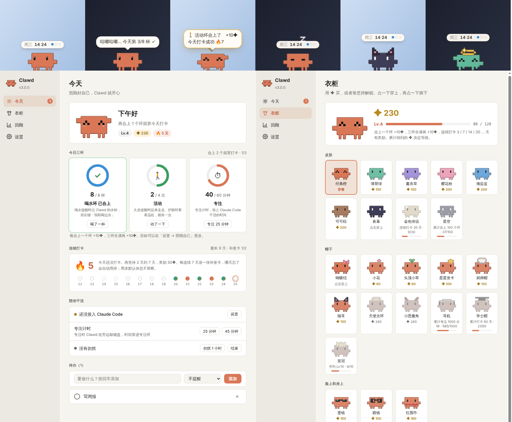

# Clawd 桌面小组件

一个住在你桌面上的 **Claude Code 吉祥物 Clawd**（橙色像素小家伙）。

**一句话：Clawd 陪你写代码，也提醒你照顾自己；你照顾好自己，Clawd 就开心、成长。**

> 非官方粉丝作品，仅供个人使用。



## Windows 直接安装

双击 `Clawd-Setup-x.x.x.exe` 按提示安装，装好后桌面和开始菜单里会有 Clawd。

第一次运行时 Windows 可能弹出「Windows 已保护你的电脑」（安装包没有付费的代码签名）：点 **更多信息 → 仍要运行**。

右键 Clawd → **控制面板…** 打开面板：**今天 / 衣柜 / 回顾 / 设置** 四页。

## 三件事

### 1. 陪你干活
- **Claude Code 联动**：Claude Code 干活时 Clawd 敲键盘，气泡里显示正在做什么（`Edit main.js`、`Bash Run tests`）和用时；
  等你批准时举手挥动（这时别的消息都会让路），做完了跳起来喊你
  - 接入：面板「设置 → Claude Code」→ **一键接入**。会在 `~/.claude/settings.json` 里加几条 http hooks（先备份成 `settings.json.clawd-backup`），随时可以一键移除
  - 原理：Clawd 在本机 `127.0.0.1:47823` 开一个只收本机请求、带口令校验的小服务，Claude Code 把事件发过来。不联网
- **专注计时**：25 / 45 分钟，专注时 Clawd 在旁边敲键盘
- **勿扰**：全屏看视频、玩游戏、PPT 放映时自动勿扰（仅 Windows），也可以手动；勿扰时提醒先攒着
- **待办**：可以设提醒时间，到点 Clawd 举手提醒

### 2. 照顾自己：今日三环
每天三个环，进度来自你真实做的事，不用另外做任务：

| 环 | 目标（可改） | 怎么算 |
| --- | --- | --- |
| 💧 喝水 | 8 杯 | 喝水提醒时点 Clawd 的水杯，或右键「我刚喝过水」 |
| 🚶 活动 | 4 次 | 久坐提醒时起来走走、护眼 20-20-20 时看看远处，或右键「我起来动过了」 |
| ⏱ 专注 | 60 分钟 | 专注计时 + Claude Code 干活的时间 |

- 合上 **2 个环**就算今天打卡，连续天数 🔥 显示在 Clawd 头顶的时钟旁边，三个小圆点是今天的三环
- 周末默认休息不算断；每连续 7 天送一张**补签卡**，哪天忘了自动用掉
- **Clawd 的心情 = 今天照顾得怎么样**：跟得上就开心、会自己跳舞；傍晚了还几乎没动就有点闷
- 早上第一次见面打个招呼；晚上 8 点还没打卡会提醒一次，告诉你离哪个环最近

### 3. 一起成长
- 只有一种货币 **✦**：每合上一个环 +10✦，三环全满再 +10✦，连续打卡 3 / 7 / 14 / 30 / 50 / 100 天有奖励
- **等级** = 累计得到的 ✦
- **衣柜**：皮肤和配饰都在这里，点一下穿上、再点一下摘下。每件东西只有一种来路：
  - 用 ✦ 买（买东西要点两下确认）
  - 坚持解锁：金色皮肤（连续打卡 30 天）、星空皮肤（累计合上 100 个环）、耳机（累计专注 1000 分钟）、学士帽（累计打卡 60 天）、皇冠（Lv.10）
  - 节日帽：元旦、春节、情人节、万圣节、圣诞、中秋、你的生日自动戴上，戴过就收进衣柜
- **回顾**：本周和上周比、每天的图表（7 / 30 天）、Clawd 每天写的小日记

### 它本身
| 操作 | 反应 |
| --- | --- |
| 单击 | 跳一下、说句话（偶尔念一下你没做完的待办） |
| 双击 | 跳舞 |
| 鼠标停在身上 | 被摸头：眯眼、脸红、冒爱心 |
| 拖动 | 手脚乱挥；散步模式下松手会掉回地面 |
| 闲着 | 呼吸、眨眼、打哈欠、伸懒腰、坐下发呆、冲鼠标挥手 |
| 电脑闲置 90 秒 | 睡觉 zZ，一动就醒 |

- 三种大小：中号 80×50（默认）、小号 64×40、大号 112×70
- **散步模式**：在任务栏上走来走去；**爬窗口**（仅 Windows）：能站到其他窗口顶上
- 电量低、CPU 一直很忙时它会流汗、提醒你；整点报时
- **自动更新**：从 GitHub Releases 检查新版本

## 自动更新

Clawd 默认从 [nimgnus21/clawd](https://github.com/nimgnus21/clawd) 的 Releases 检查新版本（启动 30 秒后和每 6 小时一次），
有新版本就后台下载、退出时安装，也可以在控制面板「关于」里点「重启并更新」。

**仓库必须是公开的**（私有仓库的 Releases 别人下载不了，自动更新会失败）。

### 发一个新版本

1. 改版本号：`npm version patch`（2.0.0 → 2.0.1；大改动用 `minor`）
2. 打包：`npm run dist:win`
3. 在 GitHub 仓库页面 → **Releases → Draft a new release**：
   - Tag 填 `v` + 版本号，比如 `v2.0.1`
   - 把 `dist/` 里这三个文件拖进去：`Clawd-Setup-2.0.1.exe`、`Clawd-Setup-2.0.1.exe.blockmap`、`latest.yml`
   - 点 **Publish release**（不要勾 pre-release）

或者设置好 `GH_TOKEN` 环境变量（一个有仓库写权限的 GitHub token）后，一条命令打包并上传：

```bash
npx electron-builder --win --publish always
```

已经装了旧版的电脑，下次检查时就会自动更新到新版。

## 隐私

- 设置、统计、待办都存在本机：`%APPDATA%\Clawd\`（`settings.json`、`data.json`，日志 `clawd.log`）
- Claude Code 联动只在本机传递，服务只监听 `127.0.0.1`，需要安装时生成的口令
- 唯一会联网的是「自动更新」：只访问 GitHub 上的发布仓库（默认 nimgnus21/clawd）

## 从源码运行 / 打包

需要 [Node.js](https://nodejs.org) 18 或更新版本。

```bash
npm install
npm start
```

国内网络装不上 Electron 时：

```powershell
$env:ELECTRON_MIRROR="https://npmmirror.com/mirrors/electron/"
npm install --registry=https://registry.npmmirror.com
```

打包（在哪个系统上打包，就生成哪个系统的安装包）：

```bash
npm run dist:win     # Windows：dist/Clawd-Setup-x.x.x.exe
npm run dist:mac     # macOS：.dmg
npm run dist:linux   # Linux：.AppImage
```

## 自己改造

| 想改什么 | 改哪里 |
| --- | --- |
| 台词 | `src/renderer/pet/lines.js` |
| 像素造型、表情、皮肤、精致渲染（描边、高光） | `src/renderer/pet/sprite.js`（16×10 网格） |
| 配饰、节日 | `src/renderer/pet/outfits.js` |
| 行为、动作 | `src/renderer/pet/pet.js` |
| 默认设置 | `src/main/config.js` |
| 三环的算法、✦ 奖励、连续打卡里程碑、衣柜价格和解锁条件 | `src/main/growth-catalog.js` |
| 日记的句子 | `src/main/diary.js` |

## 文件结构

```
src/main/           主进程
  index.js            入口，把各模块连起来
  pet-window.js       透明小人窗口：拖动、掉落、散步、爬窗口
  surfaces.js         爬窗口的“地面”计算
  winapi.js           Windows 系统接口（全屏检测、窗口位置）
  reminders.js        喝水 / 久坐 / 护眼提醒
  todos.js            待办
  dnd.js              勿扰
  claude-code.js      Claude Code hooks 服务 + 一键接入
  growth.js           今日三环、打卡、✦、等级、衣柜、心情
  growth-catalog.js   上面这些的配置（目标、奖励、价格、解锁条件）
  diary.js            日记和本周回顾
  stats.js            每日统计
  sysmon.js           CPU / 内存
  updater.js          自动更新
  panel-window.js     控制面板窗口
  menu.js             右键菜单、托盘
src/preload/        给页面暴露的接口
src/renderer/pet/   小人页面
src/renderer/panel/ 控制面板：tabs-today / tabs-wardrobe / tabs-review / tabs-core（设置）
assets/             图标
```

## 已知限制

- 自动勿扰的全屏检测、爬窗口只在 Windows 上有
- 如果你在 WSL 里用 Claude Code，需要在 WSL 的 `~/.claude/settings.json` 里手动加 hooks（地址用 Windows 主机 IP）
- Linux 上小人周围的透明区域不能点穿
- 安装包约 110MB，主要是 Electron 自带的浏览器内核
